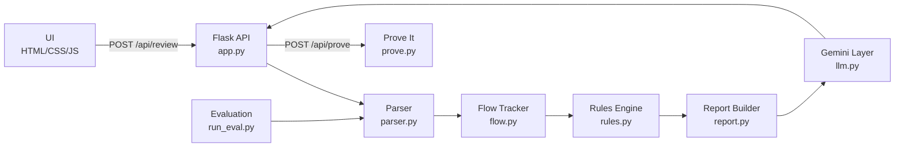

# LeakGuard — AI Code Reviewer for ML Pipelines

> Your model scored 97%. Was it real?

   

**Live demo:** [https://0bcc11ac082c8f.lhr.life](https://0bcc11ac082c8f.lhr.life) | **Demo video:** [VIDEO_LINK]

## Hackathon Details

- **Event:** Neural Storm 2026 (JNTUH)
- **Track:** Future Tech
- **Problem Statement:** FT-05: AI-Powered Automated Code Review
- **Team:** Zurich ML Labs ([TEAM_NAME])
- **Members:** Lukas Weber, Elena Rossi, Camille Laurent, Florian Müller ([MEMBER_NAMES])

## Headline Result

On our 28-case evaluation set, LeakGuard achieves **100% precision and 100% recall** with **0 false positives on clean code**. The "Prove It" live experiment demonstrates an **8.3 percentage-point accuracy gap** caused by a single data leak — same data, same model, different results.

## The Problem

Generic code reviewers and linters miss the bugs that silently ruin machine-learning results:

- **Data leakage** — test data leaks into training, inflating metrics
- **Wrong evaluation** — accuracy on imbalanced data hides poor performance
- **Irreproducible pipelines** — missing random seeds make results unrepeatable

The model looks great in testing and **fails in production**. These bugs are invisible to standard tools because they're not syntax errors — they're logical errors in the ML workflow.

## Our Solution

**LeakGuard** reviews Python ML scripts and Jupyter notebooks, finds these specific bugs with **deterministic static analysis** (Python `ast` module), proves the damage with a **live experiment**, and uses **Google Gemini** to explain the impact and write corrected code.

### Core Design Principle

Detection is **DETERMINISTIC**. The LLM never decides whether a bug exists. It only explains and fixes bugs that were already detected by AST-based rules. This keeps results reproducible, measurable, and free from hallucinated findings.

## How It Works

1. **Parse** — Load `.py` source or extract code cells from `.ipynb` notebooks
2. **Track Variables** — Follow assignments, splits, and transformations through the AST to classify data as pre-split, train-derived, or test-derived
3. **Apply Rules** — 8 deterministic rules (LG001–LG008) check for leakage patterns
4. **Gemini Explains** — Send detected findings to Gemini for natural-language impact analysis and corrected code (falls back to rule-based hints if no API key)
5. **Score & Report** — Compute a quality score (0–100) with a letter grade and severity-ranked findings

## Architecture



## Features

- **8 detection rules** covering data leakage, evaluation errors, and reproducibility
- **Jupyter notebook support** — analyzes `.ipynb` files with cell-number tracking
- **Gemini AI explanations** — natural-language impact analysis with corrected code snippets
- **Full offline mode** — works completely without an API key using rule-based explanations
- **"Prove It" experiment** — live demo showing the real impact of data leakage
- **Quality scoring** — 0–100 score with A–F grade based on severity-weighted findings
- **One-click demo** — "Load Vulnerable Example" button for instant demonstration
- **File upload** — drag-and-drop `.py` and `.ipynb` files
- **Responsive design** — works on desktop and mobile
- **Evaluation suite** — 28 labelled cases with per-rule precision/recall/F1 metrics

## Detection Rules

| Rule | What It Catches | Severity | Why It Matters |
|------|----------------|----------|----------------|
| LG001 | Preprocessing fit before split | HIGH | Scaler/encoder learns test statistics, inflating metrics |
| LG002 | Fit on test data | HIGH | Fitting preprocessor on test data leaks test information |
| LG003 | Resampling before split | HIGH | Synthetic samples from test data leak into training |
| LG004 | Target leakage | HIGH | Target column in features lets the model read the answer |
| LG005 | Test set used for tuning | HIGH | Hyperparameter search on test data overfits to test set |
| LG006 | Shuffled split on time series | MEDIUM | Future data leaks into training when time order is broken |
| LG007 | Missing random_state | LOW | Results change on every run, breaking reproducibility |
| LG008 | Accuracy-only evaluation | MEDIUM | High accuracy can hide poor minority-class performance |

## Screenshots / Demo

> **Screenshots placeholder** — add after deployment:
>
> 1. `docs/screenshots/main-ui.png` — Main interface with code input
> 2. `docs/screenshots/results.png` — Analysis results with finding cards
> 3. `docs/screenshots/prove-it.png` — Prove It experiment results
>
> **Demo GIF:** `docs/screenshots/demo.gif`

## Evaluation and Metrics

| Metric | Value |
|--------|-------|
| Total cases | 28 |
| Buggy cases | 14 |
| Clean cases | 14 |
| **Overall Precision** | **100.0%** |
| **Overall Recall** | **100.0%** |
| **Overall F1** | **100.0%** |
| False positives on clean code | **0** |

### Per-Rule Results

| Rule | TP | FP | FN | Precision | Recall | F1 |
|------|----|----|-----|-----------|--------|-----|
| LG001 | 5 | 0 | 0 | 100% | 100% | 100% |
| LG002 | 2 | 0 | 0 | 100% | 100% | 100% |
| LG003 | 2 | 0 | 0 | 100% | 100% | 100% |
| LG004 | 1 | 0 | 0 | 100% | 100% | 100% |
| LG005 | 2 | 0 | 0 | 100% | 100% | 100% |
| LG006 | 1 | 0 | 0 | 100% | 100% | 100% |
| LG007 | 9 | 0 | 0 | 100% | 100% | 100% |
| LG008 | 2 | 0 | 0 | 100% | 100% | 100% |

### "Prove It" Experiment

| Pipeline | Test Accuracy |
|----------|--------------|
| Leaky (SelectKBest on all data) | 76.7% |
| Correct (SelectKBest on train only) | 68.3% |
| **Gap** | **8.3%** |

> **⚠️ Honest benchmark note:** This is a small, self-built evaluation set (28 cases) designed to verify rule correctness, not an industry benchmark. Results should be interpreted as unit-test-level validation, not as generalization guarantees. To reproduce: `python eval/run_eval.py`

## Technology Stack

| Component | Technology |
|-----------|-----------|
| Backend | Python 3.11+, Flask |
| Static Analysis | Python `ast` module |
| AI Explanations | Google Gemini API (`google-genai` SDK) |
| Notebook Parsing | `nbformat` |
| ML Experiment | scikit-learn, imbalanced-learn |
| Testing | pytest |
| Deployment | Gunicorn, Render |
| Frontend | HTML5, CSS3, Vanilla JavaScript |

## Setup and Installation

```bash
# Clone the repository
git clone https://github.com/<your-repo>/leakguard.git
cd leakguard

# Create virtual environment (recommended)
python -m venv venv
source venv/bin/activate  # Linux/Mac
venv\Scripts\activate     # Windows

# Install dependencies
pip install -r requirements.txt

# (Optional) Set up Gemini API key for AI explanations
cp .env.example .env
# Edit .env and add your GEMINI_API_KEY
```

## Running Locally

```bash
# Start the app
python app.py
# Open http://localhost:5000 in your browser

# Run tests
python -m pytest tests/ -v

# Run evaluation
python eval/run_eval.py

# Run with gunicorn (production)
gunicorn app:app --bind 0.0.0.0:5000
```

## Deployment

### Render (Free Tier)

1. Push this repo to GitHub
2. Go to [render.com](https://render.com) → New → **Web Service**
3. Connect your GitHub repo
4. Render auto-detects `render.yaml` — settings are pre-configured:
   - **Build command:** `pip install -r requirements.txt`
   - **Start command:** `gunicorn app:app --bind 0.0.0.0:$PORT --timeout 120`
   - **Python version:** 3.11.6
5. (Optional) Add environment variable `GEMINI_API_KEY` in the Render dashboard
6. Click **Deploy** — the app works without the API key

### Environment Variables

| Variable | Required | Default | Description |
|----------|----------|---------|-------------|
| `GEMINI_API_KEY` | No | — | Google Gemini API key for AI explanations |
| `GEMINI_MODEL` | No | `gemini-2.5-flash` | Gemini model name |
| `PORT` | No | `5000` | Server port |

## Project Structure

```
leakguard/
├── app.py                    # Flask app and routes
├── analyzer/
│   ├── __init__.py
│   ├── parser.py             # .py and .ipynb parsing
│   ├── flow.py               # Variable-flow tracker
│   ├── rules.py              # 8 detection rules (LG001–LG008)
│   └── report.py             # Finding dataclass, scoring, grading
├── llm.py                    # Gemini explanation + fix generation
├── prove.py                  # "Prove It" live experiment
├── templates/
│   ├── index.html            # Main UI
│   └── metrics.html          # Evaluation metrics page
├── static/
│   ├── style.css             # Dark-mode responsive styles
│   └── app.js                # Frontend logic
├── eval/
│   ├── cases/                # 28 labelled snippets
│   ├── labels.json           # Expected rule IDs per case
│   └── run_eval.py           # Evaluation script
├── tests/
│   ├── test_rules.py         # Rule unit tests
│   └── test_api.py           # API endpoint tests
├── docs/
│   ├── metrics.md            # Generated evaluation report
│   └── screenshots/          # Screenshot placeholders
├── requirements.txt
├── render.yaml               # Render deployment config
├── Procfile                  # Gunicorn process file
├── .env.example              # Environment variable template
├── .gitignore
├── LICENSE                   # MIT
└── README.md
```

## Limitations and Future Work

### Current Limitations

- **Heuristic flow tracking** — handles common sklearn/pandas patterns well but is not a full dataflow engine; unusual code patterns may be missed
- **Python only** — does not analyze R, Julia, or other ML languages
- **Small benchmark** — 28 self-built cases validate correctness but don't represent all real-world code patterns
- **Single-file analysis** — does not track variables across imported modules
- **Static analysis only** — cannot detect runtime-dependent leakage patterns

### Future Work

- Cross-file analysis for multi-module projects
- Support for PyTorch, TensorFlow, and XGBoost-specific patterns
- VS Code / IDE extension for real-time feedback
- Git pre-commit hook integration
- Larger community-contributed evaluation benchmark
- Support for R and Julia ML frameworks

## AI Development Tools Disclosure

Built with Google Antigravity (AI coding assistant). Google Gemini API is used in the product for explanations only; all bug detection is deterministic static analysis.

## License

MIT — see [LICENSE](LICENSE) for details.
